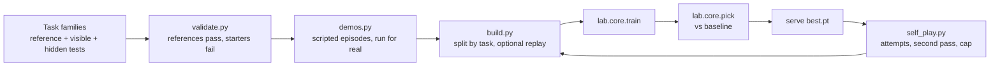

# Expert iteration and self-play

## How it works

**Expert iteration** is a loop for teaching a model a job you can *check automatically*:

1. Give the model many tasks with an automatic checker (tests pass, the CAD part meets its spec).
2. Let it attempt each task, sometimes several times, at a non-zero temperature.
3. **Keep only the attempts the checker verifies.**
4. Train on those successful trajectories, then go back to step 1 with the improved model.

The model learns from its own best behaviour, in its own words, on prompts it will actually see.
In the copilot, scripted repair data alone did not transfer; adding the model's own verified runs
is what moved scores.

### Scripted demonstrations come first

A fresh model solves almost nothing, so round 1 trains on **scripted demos**: a program that knows
the answer drives the same agent loop, and every observation in the demo is what the real sandbox
printed. Demos also teach habits a model rarely discovers alone:

| Demo shape | Habit it teaches |
|---|---|
| `implement` | Read the tests or header, write the module, run, finish. |
| `fix` | Run the tests, read, replace the faulty line, re-run. |
| `recover` | Write a realistic bug, see the failure, repair from the output. |
| `wrong_api` | Skip reading, guess a wrong name, read the error, go back and read the file. |
| `bad_edit` | Send an edit whose SEARCH text isn't there; redo it from the lines shown. |
| `trace_fix` | Read the failing **test** to see what it calls before touching the source. |
| `recover2` / `fix2` | Two bugs: after the first fix a *different* check fails, so **re-read the file** before the second edit. |

The *mistake* steps in recovery demos are not trained (only the recovery is), so the model never
learns to make the mistake.

### Lessons about self-play

- **It goes lopsided.** Easy families give full sets, hard ones give a few rows. Fixes: a **second
  pass** with more attempts for any (family, kind) solved less than 80 % of the time (`--weak-below`),
  and a **cap** on solved episodes per (family, kind) (`--cap-solved`).
- **It runs out of signal.** Coder round 4's model solved 766 of 768 tasks: training on that teaches
  nothing new. Harder task kinds (`fix2`) and new families restore the signal.
- **The checker must check the right thing.** In Forge v18, 79 of 169 "verified" runs passed the
  requirement checks with a *different* part than the goal described. Verified ≠ correct unless the
  checker is tight.
- **Only the current round's self-play.** Older rounds were recorded under an older harness, so their
  observations no longer match what the model sees.
- **A family the model can't solve is taught by demos.** `c_pixel` self-play solved 5 of 96 before
  training, but its demos took it to 8/8 at eval.

## How it is implemented (coder)

See [Coder pipeline](../projects/coder-pipeline.md) for the modules and [Coder rounds](../projects/coder-rounds.md)
for what each round taught.
