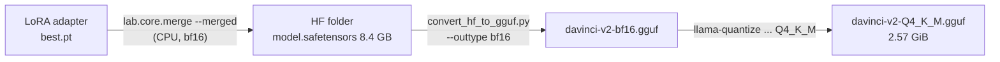

# Quantization and GGUF

## How it works

### Why quantize

A model's weights are normally 16-bit numbers. Qwen3.5-4B in bf16 is 8.4 GB. On a CPU-only server,
every generated token reads **all** the weights from RAM, so file size directly sets speed — and it
must fit in the container's memory. **Quantization** stores each weight in fewer bits.

### How block quantization works

Weights are split into small **blocks**. Each block stores a shared **scale** (and sometimes a
minimum), and every weight as a small integer. To use a weight: `value ≈ scale × integer (+ min)`.
Fewer bits per weight → smaller and faster, but coarser.

### The formats used or discussed

| Type | Family | Bits/weight (approx.) | Notes |
|---|---|---|---|
| `bf16` | unquantized | 16 | The conversion output; 8.4 GB for the 4B. Not served. |
| `Q8_0` | legacy | 8.5 | Near-lossless. v1 also had a Q8 build. |
| **`Q4_K_M`** | K-quant | ~5.1 measured here | **What `davinci` runs.** The usual best balance. 2.57 GiB for the 4B. |
| `Q4_0` | legacy | ~4.5 | 32-weight blocks, one fp16 scale. Fast CPU kernels (llama.cpp repacks it for AVX2 at load), noticeably more loss than Q4_K_M. |
| `Q3_K_M` | K-quant | ~3.9 | Smallest considered; clearly more loss; small models suffer most. |

**K-quants** use two-level blocks (a 256-weight super-block of 16 sub-blocks, each with its own
quantized scale) so fewer bits are wasted. The suffix `_S`/`_M`/`_L` says how many sensitive tensors
(attention value, FFN down, output) are kept at higher precision: `_M` = medium.

**Importance matrix (imatrix)**: run sample text through the model, record which weights matter
most, and let the quantizer protect them. Worth doing below 4 bits.

### Trade-off summary

| | Q4_K_M | Q4_0 | Q3_K_M |
|---|---|---|---|
| Size (4B) | 2.57 GB | ~2.3 GB | ~2.0 GB |
| Quality loss | small | more | most |
| CPU speed | baseline | fastest 4-bit on x86 | faster by size, slower kernels |
| Use when | default | speed matters, some loss OK | speed matters most; use an imatrix |

Expected speed gain on the home server from either alternative: ~10–30 %, not 2×. Only a smaller
model (2B) roughly doubles speed.

### GGUF

**GGUF** is llama.cpp's single-file format: weights (any quant type), tokenizer, chat template and
model metadata together. One file is everything the server needs.

## How it is implemented (the export chain)



## How to use it

```powershell
$py = "C:\Users\<you>\Documents\Books\How_to_make_a_reasoning_model_from_scratch\My_work\.venv\Scripts\python.exe"
cd C:\Users\<you>\Documents\Books\Pipeline_assistant

# 1. merge (CPU so a running training round keeps the GPU)
$env:CUDA_VISIBLE_DEVICES = ""
& $py -m lab.core.merge --model configs\models\qwen3.5-4b-4bit.json --adapter runs\assistant-v2\best.pt --merged out\davinci-v2-merged

# 2. convert (the Windows venv has torch/transformers; the script lives in WSL's llama.cpp)
& $py "\\wsl.localhost\Ubuntu\home\<you>\llama.cpp\convert_hf_to_gguf.py" out\davinci-v2-merged --outtype bf16 --outfile out\davinci-v2-bf16.gguf
```

```bash
# 3. quantize (WSL, ~2 minutes)
cd ~/llama.cpp
build/bin/llama-quantize /mnt/c/.../out/davinci-v2-bf16.gguf /mnt/c/.../out/davinci-v2-Q4_K_M.gguf Q4_K_M 8
# other types: Q4_0, Q3_K_M, Q5_K_M, Q8_0

# optional importance matrix for low-bit types
build/bin/llama-imatrix -m davinci-v2-bf16.gguf -f calibration.txt -o imatrix.dat
build/bin/llama-quantize --imatrix imatrix.dat davinci-v2-bf16.gguf davinci-v2-Q3_K_M.gguf Q3_K_M
```

Always smoke-test the result before deploying (see the [deploy runbook](../infrastructure/deploy-model.md#4-smoke-test-locally)).
