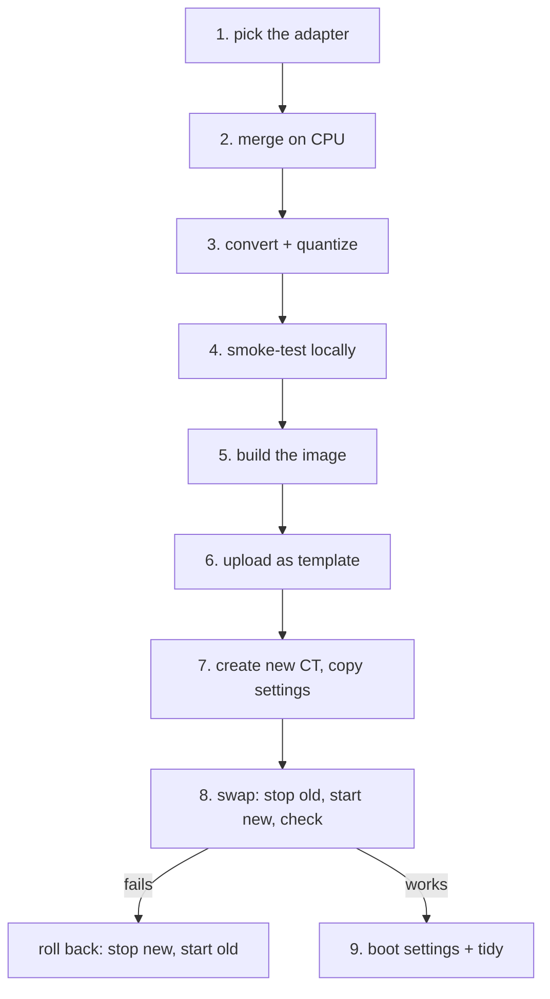

# Runbook: deploy a model to the home server

How assistant v2 was deployed on 11-21, step by step, so the next version can follow the same path.
Total time ~1 hour, of which the server is down for about one minute.



## Before you start

- `PVE_TOKEN` is set in the Windows environment (see [Proxmox](proxmox.md#the-api-and-tokens)).
- ~20 GB free on `C:` for the intermediate files.
- The GPU can stay busy: everything here runs on the CPU.

## 1. Pick the adapter

Use the run's `best.pt` (copied by `pick`) and read `pick.json` to confirm what it is. v2: `runs\assistant-v2\best.pt` = `lora-final.pt`, judge 0.70.

## 2. Merge (CPU, ~10 min, ~9 GB RAM for a 4B)

```powershell
cd C:\Users\<you>\Documents\Books\Pipeline_assistant
$py = "C:\Users\<you>\Documents\Books\How_to_make_a_reasoning_model_from_scratch\My_work\.venv\Scripts\python.exe"
$env:CUDA_VISIBLE_DEVICES = ""
& $py -m lab.core.merge --model configs\models\qwen3.5-4b-4bit.json --adapter runs\assistant-v2\best.pt --merged out\davinci-v2-merged
```

Check the log says `merged layers: 200` (4B) and `config.json` lists `Qwen3_5ForCausalLM`.

## 3. Convert and quantize (~5 min)

```powershell
& $py "\\wsl.localhost\Ubuntu\home\<you>\llama.cpp\convert_hf_to_gguf.py" out\davinci-v2-merged --outtype bf16 --outfile out\davinci-v2-bf16.gguf
wsl.exe --cd /home/<you>/llama.cpp -e build/bin/llama-quantize /mnt/c/Users/<you>/Documents/Books/Pipeline_assistant/out/davinci-v2-bf16.gguf /mnt/c/Users/<you>/Documents/Books/Pipeline_assistant/out/davinci-v2-Q4_K_M.gguf Q4_K_M 8
```

Result: `quant size = 2572.86 MiB (5.13 BPW)`.

## 4. Smoke-test locally

Run `tools/smoke.sh` in WSL (starts `llama-server` on 8181, asks one question, stops it). Expect
`finish_reason: stop` and a sensible two-sentence answer. Never deploy a file you haven't talked to.

## 5. Build the image

```powershell
cd out
& $py ..\..\..\lab-wiki\tools\swap_model_layer.py davinci-llamacpp.tar davinci-v2-Q4_K_M.gguf davinci-v2.tar davinci-v2
& $py ..\..\..\lab-wiki\tools\verify_oci.py davinci-v2.tar
```

How it works: [Docker and OCI images](docker-oci.md#the-davinci-model-images-no-docker-needed).

## 6. Upload (~3 min on the LAN)

```bash
curl -sk -H "$H" -F content=vztmpl -F "filename=@davinci-v2.tar" $B/nodes/server/storage/local/upload
```

Poll the returned UPID until `stopped OK`, then check the template's size in
`storage/local/content?content=vztmpl` equals the local file.

## 7. Create the new container, stopped

Use the next free CTID, the **same** hostname, IP, memory, cores and network as the running one, and
`onboot=0` for now (recipe in [Proxmox](proxmox.md#how-to-use-it-api-recipes)). Then copy the old
container's whole `env` value to the new one and diff them — v1 had `LLAMA_ARG_REASONING=off`
added by hand, which the image doesn't carry.

## 8. Swap, check, roll back if needed

`tools/swap_ct.sh` does all of this:

1. shut down the old CT (`timeout=30`);
2. start the new CT;
3. wait up to 3 minutes for `/health`;
4. check `/v1/models` shows the new parameter count and size, and one chat reply ends with `stop`;
5. **if anything fails**: stop the new CT and start the old one.

v2's check: `n_params 4205751296`, `Q4_K - Medium`, reply ended `stop`.

## 9. Boot settings and tidy-up

- New CT `onboot=1`; old CT `onboot=0` and left **stopped** for rollback (delete only when sure).
- Tune threads if needed ([CPU speed](../concepts/inference-performance.md)).
- `out\davinci-v2-merged\` and `out\davinci-v2-bf16.gguf` (~17 GB) can be deleted; keep the Q4_K_M
  GGUF and the image tar.

## Rolling back later

```bash
curl -sk -H "$H" -X POST --data timeout=30 $B/nodes/server/lxc/101/status/shutdown
curl -sk -H "$H" -X POST $B/nodes/server/lxc/100/status/start
curl -sk -H "$H" -X PUT --data onboot=0 $B/nodes/server/lxc/101/config
curl -sk -H "$H" -X PUT --data onboot=1 $B/nodes/server/lxc/100/config
```
