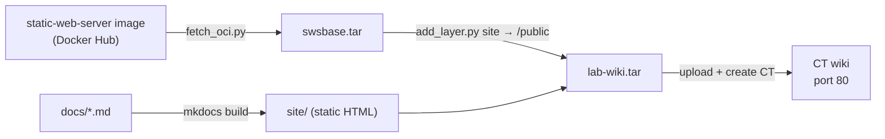

# Runbook: this wiki

## How it works

- **Source:** Markdown pages in `C:\Users\<you>\Documents\lab-wiki\docs\`, navigation and theme in
  `mkdocs.yml`.
- **Builder:** [MkDocs](https://www.mkdocs.org/) with the Material theme, installed in WSL at
  `~/venvs/wiki`. It turns the Markdown into a static website in `site/` (HTML, CSS, JS and a search
  index — no server-side code).
- **Server:** the `static-web-server` image (a single Rust binary that serves `/public` on port 80),
  plus one extra layer holding `site/` at `/public`. Built as an OCI archive without Docker
  (`tools/fetch_oci.py` + `tools/add_layer.py`) and run as a Proxmox container `wiki` (its CTID changes with each update).



## How to use it

### Edit and preview

```bash
cd /mnt/c/Users/<you>/Documents/lab-wiki
~/venvs/wiki/bin/mkdocs serve -a 127.0.0.1:8000     # live preview while editing
```

Add a page: create `docs/<section>/<page>.md`, then add it to `nav:` in `mkdocs.yml`.

### Build and redeploy

The site's files live inside the image, so every update is a **new image and a new container**,
swapped in for the old one (about 10 seconds of downtime).

```bash
# 1. build (strict = fail on broken links)
cd /mnt/c/Users/<you>/Documents/lab-wiki && ~/venvs/wiki/bin/mkdocs build --strict
```

```powershell
# 2. package (the base image is cached in build\swsbase.tar after the first fetch)
cd C:\Users\<you>\Documents\lab-wiki
& $py tools\fetch_oci.py joseluisq/static-web-server:2 build\swsbase.tar      # first time only
& $py tools\add_layer.py build\swsbase.tar site /public build\lab-wiki.tar lab-wiki
& $py tools\verify_oci.py build\lab-wiki.tar
```

```bash
# 3. upload as lab-wiki-<tag>.tar, create <new ct>, stop <old ct>, start the new one, check it,
#    then destroy the old container and its template (rolls back if the new one fails)
cd /c/Users/<you>/Documents/lab-wiki
bash tools/update_wiki.sh <new ct> <old ct> <tag>       # e.g. 103 102 20261122b
```

!!! warning "Two traps hit on 2026-11-23"
    - **Run step 2 from PowerShell, not Git Bash.** Git Bash rewrites the argument `/public` into
      `C:/Program Files/Git/public`, and the site lands in the wrong folder. In Git Bash, run
      `export MSYS_NO_PATHCONV=1` first. `verify_oci.py` prints the layer path: check that it says `/public`.
    - **The same setting broke the health check.** With `MSYS_NO_PATHCONV=1`, Windows `curl` gets
      `-o /dev/null` literally, cannot write that file and exits with code 23, so the script's check
      failed and rolled back three good containers. The check now redirects with the shell
      (`curl … >/dev/null`), which works either way. If an update ever rolls back, the new container
      is left stopped: shut the old one down, start the new one and test it by hand before blaming the image.

## Where it is

| | |
|---|---|
| Address | **<http://<wiki-host>/>** |
| Container | Proxmox CT `wiki` on node `server` (the newest CTID; see [Proxmox → Guests](proxmox.md#guests)) |
| Resources | 1 core, 256 MB RAM, 1 GB disk; starts on boot |

!!! tip "Reserve the address"
    `<wiki-host>` is set statically in the container. If the router hands out addresses by DHCP
    in that range, reserve `.30` and `.31` there so nothing else takes them.
