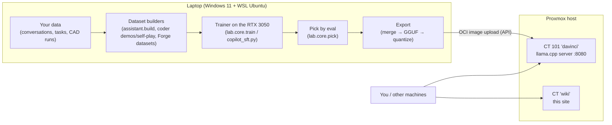

# The big picture

## What this lab is for

The aim running through every project is: **take a small open model that fits on a laptop, and
make it genuinely good at one job** — chatting like you, writing and fixing code, or driving a CAD
program — then **serve it on cheap hardware** at home.

Three facts shape almost every design decision:

1. **One 6 GB GPU.** Everything trains on a laptop RTX 3050 with 6 GB of video memory and 32 GB of
   system RAM. That rules out full fine-tuning; it is why everything uses [LoRA](../concepts/lora-qlora.md),
   gradient checkpointing, 4-bit loading and careful length caps.
2. **Small models fail in specific, readable ways.** A 2B model doesn't fail randomly; it repeats the
   same broken edit, forgets to mask a value, or stops at the wrong token. Most progress came from
   **reading transcripts of failures**, finding the habit, and teaching the opposite habit.
3. **A score is only as good as the test.** Several "results" turned out to be measuring the wrong
   thing (a serving bug, a boxed-answer format, a verifier that passed the wrong part). Every pipeline
   now picks checkpoints by a real task eval, keeps held-out families, and reports noise.

## How the pieces fit

## The projects and how they relate

| Project | Relationship |
|---|---|
| **Forge CAD** (`~/cad`) | The product. Its copilot is an AI agent that builds parts through Forge's operation API. |
| **Forge copilot training** (`Pipeline_copilot`) | The first training pipeline (v4 → v19). Every hard lesson about small-model training was learned here first. |
| **Assistant + coder pipelines** (`Pipeline_assistant`, `Pipeline_coder`) | The second generation: the copilot's lessons rebuilt as **model-agnostic** code (`lab/core`), applied to a chat assistant and a coding agent. The core is duplicated in both repos. |
| **Pipeline_claude** and **Astra** | Learning projects built from two books (*LLM from scratch*, *Reasoning model from scratch*): pretraining, distillation and reinforcement learning on maths. |
| **Proxmox + llama.cpp** | Where finished models run, on a CPU-only home server. |

## The recurring loop

Almost every project runs the same cycle, called a **round**:

1. **Build data** — scripted demonstrations, your own logs, and the model's own verified successes.
2. **Check the data** — references must pass, lengths measured with the real tokenizer, nothing silently dropped.
3. **Train** a LoRA adapter on the GPU (hours to days).
4. **Evaluate** every few checkpoints on held-out tasks, and **pick** the best — never just the last.
5. **Read failures** — open real transcripts, find the habit behind the failures.
6. **Change the data or the harness**, then go round again.

The [timeline](timeline.md) shows each round in order; [Expert iteration](../concepts/expert-iteration.md)
explains why step 1 includes the model's own successes.
